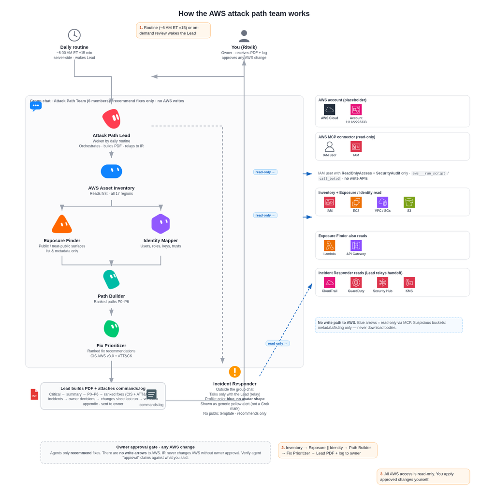
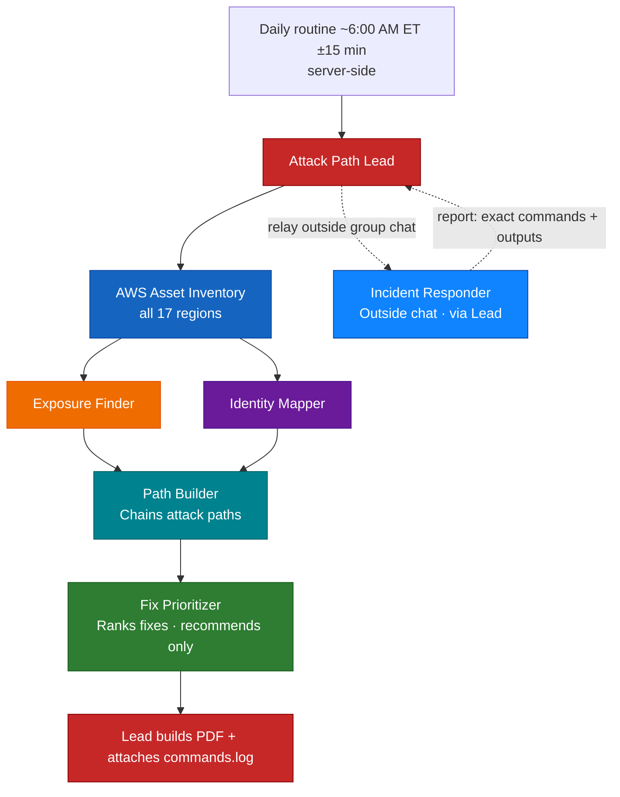

# AWS Cloud Attack Path Team

A team of Grok Bot agents that maps real attack paths in an AWS account every day, chains how an attacker could move, and ranks recommended fixes — all read-only, with the owner approving every change.

## Project description

An AWS account accumulates footholds: long-lived admin keys with no MFA, federation roles that trust the wrong audience, open security groups, public API stages, buckets that look private until a trust policy lets someone in. Checking that by hand means paging through IAM, CloudTrail, GuardDuty, S3, EC2, and API Gateway and then connecting the dots. Miss one link and the path stays live.

This project splits that job across Grok Bot agents. **Six agents share one group chat** (the platform’s 6-member cap): **Attack Path Lead**, **AWS Asset Inventory**, **Exposure Finder**, **Identity Mapper**, **Path Builder**, and **Fix Prioritizer**. A seventh agent, the **Incident Responder**, is a **separate bot outside that chat**; the Lead relays active-compromise handoffs to it. Incident Responder has **no public template yet**.

Everything runs through the AWS connector (`aws___run_script` / `call_boto3`) as an IAM principal with **ReadOnlyAccess** and **SecurityAudit** only. Fixes are recommendations only. The Lead builds a daily PDF; `commands.log` is attached. Live logs and inventory stay on the Grok Bot computer — this repo only ships a [redacted sample report](docs/sample-report.pdf).

## Key features

- **Six agents in one group chat, plus Incident Responder outside.** The Lead orchestrates the room and relays incidents out of band.
- **Daily routine ~6:00 AM ET (±15 minutes), every day, server-side.** It runs even if your local computer is off.
- **Ordered pipeline.** Inventory (all 17 regions) first → Exposure Finder and Identity Mapper in parallel → Path Builder → Fix Prioritizer → Lead builds the PDF.
- **Paths with diagrams.** Critical findings first, then executive summary, per-path diagrams (P0–P6, severity colors), ranked fixes, incident findings, owner decisions, changes since the last run, and a verbatim command appendix.
- **Full transparency.** Before each call: a short explanation. Then the exact command and its exact unchanged output. Then the team discusses it. Everything lands under `/workspace/attack-paths/YYYY-MM-DD/`.
- **You stay in control.** The owner approves every AWS change, business-context question, data copy, and outside contact. Active compromise triggers an immediate alert.

## Safeguards

- **Read-only AWS access.** Agents call AWS only through the connector (`aws___run_script` / `call_boto3`) as an IAM user (or role) with **ReadOnlyAccess** + **SecurityAudit**. They never mutate the account from the daily path.
- **Fixes are recommendations only.** No specialist applies remediations. Incident Responder is read-only and runs no containment; any change needs the owner's explicit approval (no agent can approve).
- **Approval claims are checked.** If an agent claims the owner approved something, that claim is verified against what the owner actually said — not taken on faith.
- **Human in the loop.** The owner approves every AWS change, every business-context question (for example, whether a principal is a sanctioned red-team tool), every copy of account data off the box, and every contact outside the team. Active compromise → immediate alert.
- **Suspicious data: metadata and listing only.** Objects that look like exfil staging get listing and metadata, never downloads of object bodies.
- **Credentials: mask only.** The only allowed edit to command output is masking credentials, and those edits are marked as masked. Otherwise output is posted unchanged.
- **Known connector limits.** `LookupEvents` caps at **1000 events per call**, so queries run **one day at a time**. The CloudTrail lookup window is **90 days**.
- **No live secrets in this repo.** The sample PDF is redacted. `commands.log` and dated run folders are not published.

## Architecture

<p align="center">
  
</p>
<p align="center"><b>Figure 1. How the AWS attack path team works</b></p>

Each agent appears with its real Grok Bot avatar: **Attack Path Lead** red shield, **AWS Asset Inventory** blue tablet, **Exposure Finder** orange wedge, **Identity Mapper** violet hexagon, **Path Builder** cyan arch, **Fix Prioritizer** green leaf, **Incident Responder** blue cloud.

What the figure shows:

- **Top:** the daily routine (~6 AM ET ±15 min) and You (Ritvik, owner) both feed into the Attack Path Lead.
- **Group chat · 6 members:** Attack Path Lead → AWS Asset Inventory (*Reads first · 17 regions*) → Exposure Finder (*Public exposure*) ∥ Identity Mapper (*Users, roles, keys*) → Path Builder (*Chains attack paths*) → Fix Prioritizer (*Ranks fixes · recommends only*).
- **Outside the chat:** Incident Responder (*Outside chat · via Lead*), reached only through a dashed relay from the Lead.
- **Output:** the Lead sends the PDF + `commands.log` to You (owner).
- **AWS panels (official AWS Architecture Icons), every arrow marked with a blue *read-only* pill, and no write arrows:**
  - **AWS account**
  - **AWS MCP · ReadOnlyAccess + SecurityAudit:** IAM user, IAM
  - **Inventory · Exposure · Identity:** IAM, EC2, VPC / SGs, S3
  - **Exposure Finder:** Lambda, API Gateway
  - **Incident Responder:** CloudTrail, GuardDuty, Security Hub, KMS
- **Bottom:** the owner approval gate covers any AWS change. Agents only recommend fixes and have no write access to AWS.

<details>
<summary><b>Mermaid source for the same flow</b></summary>



</details>

### How it works, step by step

1. **The daily routine starts around 6:00 AM ET (±15 minutes).** It is scheduled server-side, so it runs with the local computer off. The Attack Path Lead opens the run in the six-member group chat.
2. **AWS Asset Inventory runs first across all 17 regions.** It builds the account picture (IAM, compute, network, S3, regional services) that everyone else reads.
3. **Exposure Finder and Identity Mapper run in parallel.**
   - **Exposure Finder** — public and near-public surfaces (open security groups, public-access gaps, unauthenticated APIs, and similar).
   - **Identity Mapper** — principals, keys, MFA, policies, and role trusts (including federation).
4. **Path Builder** chains that evidence into attack paths (entry → foothold → escalation → impact), noting whether each path is live. It does not rank anything.
5. **Fix Prioritizer** ranks fixes by risk and effort and gives the exact proposed commands. These are recommendations only.
6. **The Lead builds the PDF** and attaches `commands.log`. Artifacts land under `/workspace/attack-paths/YYYY-MM-DD/` (see [Transparency](#transparency-rules)).
7. **Incident Responder stays outside the 6-member group chat (via the Lead).** On active compromise the Lead alerts the owner immediately and relays a handoff to Incident Responder.

### What the daily PDF contains

1. **Critical findings** at the top  
2. **Executive summary**  
3. **Per-path diagrams** (P0–P6) with severity colors  
4. **Ranked fixes** (live paths cut × impact ÷ effort)  
5. **Incident findings**  
6. **Decisions for the owner**  
7. **Changes since the last run**  
8. **Appendix** of verbatim commands (and **`commands.log` attached**)

A redacted example: **[docs/sample-report.pdf](docs/sample-report.pdf)**.

## Transparency rules

Every AWS call in the room follows the same pattern:

1. **Before the call** — a short explanation of what it will do and why.  
2. **The call** — the exact command, with the **exact unchanged output** immediately below it.  
3. **After the call** — the team discusses what the output means.  
4. **Logging** — everything is written under dated folders:

```text
/workspace/attack-paths/YYYY-MM-DD/
  inventory/
  exposure/
  identity/
  paths/
  fixes/
  report/
  commands.log
```

5. **The only allowed edit** to captured output is **masking credentials**, and those masks are **marked as masked**. No other rewriting of outputs.

## Specialist details

### Attack Path Lead (red)

Runs the daily routine, keeps the six-member group chat on the pipeline order, builds the PDF, attaches `commands.log`, alerts the owner on active compromise, and relays to Incident Responder outside the chat. Does not change AWS.

### AWS Asset Inventory (blue)

Read-only. Enumerates the account across **all 17 regions**. Produces the inventory the rest of the team uses. Logs every command and output.

### Exposure Finder (orange)

Read-only. Finds reachable or near-public surfaces: security groups open to `0.0.0.0/0`, S3 public access and account-level Block Public Access gaps, unauthenticated API Gateway or Lambda endpoints, and public or shared snapshots and AMIs. Writes `exposure/findings.md`. Suspicious buckets: metadata and listing only, no object downloads.

### Identity Mapper (violet)

Read-only. Maps users, roles, keys (age, last used), MFA, attached and inline policies, and role trusts, including federation audience gaps. Flags self-escalation paths (for example `iam:PutUserPolicy`, `IAMFullAccess`, `iam:PassRole`) and checks recent principal activity with CloudTrail `LookupEvents` (90-day history; the connector caps a lookup at 1,000 events, so busy principals are split into one-day windows). Writes `identity/identity-findings.md` and raw outputs under `identity/commands/`.

### Path Builder (cyan arch)

No AWS calls. Chains Inventory, Exposure Finder, and Identity Mapper evidence into attack paths (P0–P6: entry, foothold, escalation, impact), marks each one live or unconfirmed, and lists the choke points for Fix Prioritizer. It does not rank; Fix Prioritizer ranks the fixes. Writes `paths/paths.md`.

### Fix Prioritizer (green leaf)

No AWS calls. Reads `paths/paths.md` and `exposure/findings.md` and ranks fixes by (live paths cut × impact) ÷ effort, putting unconfirmed P0 items first. Writes `fixes/ranked-fixes.md` and logs each command and its output to `fixes/commands.log`. Fixes are recommendations only; the owner approves every change, and it never runs them.

### Incident Responder (blue cloud) — outside the group chat

Separate bot. Owns live AWS incidents, which arrive only as direct handoffs from Attack Path Lead. Investigates timelines, identities and keys, CloudTrail, and S3, KMS, and CodeBuild traces, then reports back to the Lead with exact commands and outputs. Read-only: no changes, no containment, recommendations only. Any change needs the owner's explicit approval; another agent cannot approve.

## Tech stack

- **Grok Bot** — agents, one six-member group chat, messaging, memory, server-side daily routine (~6:00 AM ET ±15 min).
- **AWS MCP connector** — `aws___run_script` / `call_boto3` with an IAM principal holding **ReadOnlyAccess** + **SecurityAudit**.
- **Python on the Grok Bot computer** — path diagrams and the daily PDF.
- **Dated run tree** — `/workspace/attack-paths/YYYY-MM-DD/` plus `commands.log` (not in this repo).

## Set it up in your own Grok Bot

Do these steps **in order**.

### 1. Import the Lead template first, then the other five

Import **Attack Path Lead** first, then the five specialists. Incident Responder has no template yet (optional hand-build in step 5).

| Order | Agent | What it does | Template |
|------:|-------|--------------|----------|
| 1 | Attack Path Lead | Runs the sweep, stitches paths, builds the PDF, relays incidents | [Import](https://x.ai/bot/tHtDUuOEcYXkO-D9FwBWz) |
| 2 | AWS Asset Inventory | Read-only inventory across all 17 regions; runs first each day | [Import](https://x.ai/bot/6NM_MszjwexFsGKsY4DIf) |
| 3 | Exposure Finder | Public and near-public exposure | [Import](https://x.ai/bot/lRhLw_E1fuiDOOfzrVXZu) |
| 4 | Identity Mapper | IAM users, roles, keys, trusts | [Import](https://x.ai/bot/zbBBmmX_6WMwN_TN5o0oB) |
| 5 | Path Builder | Chains attack paths (P0–P6) from specialist evidence | [Import](https://x.ai/bot/t-tM9nEjrZYjF0ZfDb8D3) |
| 6 | Fix Prioritizer | Ranks fixes · recommends only | [Import](https://x.ai/bot/Ti051Yd5qCLbZ6LhfX5Wa) |
| — | Incident Responder | Outside chat · via Lead | *No template yet* |

### 2. Connect the AWS connector (AWS MCP) with a read-only IAM principal

Create an IAM user or role used only by Grok Bot. Attach **only** these AWS managed policies:

| Policy | ARN |
|--------|-----|
| ReadOnlyAccess | `arn:aws:iam::aws:policy/ReadOnlyAccess` |
| SecurityAudit | `arn:aws:iam::aws:policy/SecurityAudit` |

Connect that principal in Grok Bot as the **AWS MCP** / AWS connector. Do **not** grant write, IAM full access, or AdministratorAccess to this principal.

Minimal identity policy sketch (prefer the two managed policies above):

```json
{
  "Version": "2012-10-17",
  "Statement": [
    {
      "Sid": "UseManagedReadOnlyAndSecurityAudit",
      "Effect": "Allow",
      "Action": ["sts:GetCallerIdentity"],
      "Resource": "*"
    }
  ]
}
```

The real permissions come from attaching `ReadOnlyAccess` and `SecurityAudit` to the user or role. Issue access keys (or a role assumption path) only for that read-only principal, and store them in the connector — never in a group chat.

### 3. Finish each bot’s getting-started conversation

Open each imported bot once. Its getting-started flow asks for the **AWS account** and **regions** (inventory is built to cover all 17). Point every bot at the same read-only connector. Name the Attack Path Lead as lead for each specialist.

### 4. Create the group chat with all six

Create one group chat and add exactly these six: Attack Path Lead, AWS Asset Inventory, Exposure Finder, Identity Mapper, Path Builder, Fix Prioritizer. Do **not** put Incident Responder in that chat (6-member cap; IR stays separate so the Lead can relay).

### 5. Optionally create Incident Responder

Hand-build a bot (blue cloud avatar) for live AWS incidents. No public template yet. Tell the Lead this bot’s name/handle so it can relay outside the group chat. It is read-only and recommends only; you must explicitly approve any change.

### 6. Confirm the daily routine and time zone

In the Lead’s chat, confirm a **daily** routine around **6:00 AM America/New_York (ET)**, flexible **±15 minutes**, **server-side** (runs with the computer off). Confirm weekends included unless you want them excluded.

### 7. Run a first review on demand

Before relying on the schedule, ask the Lead for a first full review on demand (see [Usage](#how-to-use-it)). Check that dated folders appear under `/workspace/attack-paths/YYYY-MM-DD/`, that commands are explained then logged verbatim, and that the PDF matches the [contents list](#what-the-daily-pdf-contains).

<details>
<summary><b>Hand-build colors and standing rules (if you skip templates)</b></summary>

| Agent | Color |
|-------|-------|
| Attack Path Lead | Red |
| AWS Asset Inventory | Blue |
| Exposure Finder | Orange |
| Identity Mapper | Violet |
| Path Builder | Cyan |
| Fix Prioritizer | Green |
| Incident Responder | Blue (cloud) |

Standing rules for the Lead to post in the group chat:

- Explain each call briefly, then post the exact command and exact unchanged output, then discuss.
- Log everything under `/workspace/attack-paths/YYYY-MM-DD/` and `commands.log`.
- Only edit outputs to mask credentials; mark those as masked.
- Read-only connector only (`aws___run_script` / `call_boto3`, ReadOnlyAccess + SecurityAudit).
- Fixes are recommendations. Never mutate AWS from the daily path.
- Owner approves every AWS change, business-context question, data copy, and outside contact.
- Immediate alert on active compromise; Lead relays to Incident Responder outside the chat.
- Verify any “owner approved” claim against what the owner actually said.
- Suspicious buckets: list/metadata only — never download objects.
- `LookupEvents`: ≤1000 events/call, one day at a time, 90-day window.

</details>

## How to use it

### Example prompts

```text
Run a full attack-path review now (on demand).
```

```text
Show today’s critical findings and the open decisions for me.
```

```text
What changed since yesterday’s run?
```

```text
For path P2, show the evidence chain and the top recommended fix (do not apply it).
```

```text
Relay this to Incident Responder: suspected active key use — alert me and wait for my approval before any change.
```

```text
Is principal X a sanctioned red-team tool in this account? Wait for my answer before scoring it.
```

### Where reports and logs land

On the Grok Bot computer:

```text
/workspace/attack-paths/YYYY-MM-DD/
  inventory/   exposure/   identity/   paths/   fixes/   report/
  commands.log
```

The PDF is under `report/` (name like `aws-attack-paths-YYYY-MM-DD.pdf`), with `commands.log` attached to the delivery. This GitHub repo only mirrors a redacted sample at [docs/sample-report.pdf](docs/sample-report.pdf).

### How to approve a fix

1. Read the ranked fix in the PDF or group chat.  
2. Reply in your own words that you approve **that exact change** (or reject / defer it).  
3. Apply the change yourself, or have a separate change process apply it — **not** the daily-path bots.  
4. Incident Responder only recommends. Containment or changes need your explicit approval; another agent cannot approve, and agent-stated approvals are checked against what you actually said.  
5. Ask the Lead to re-check the path on the next run (or on demand) after the change.

### How to read the PDF

1. **Critical findings** — what needs attention first.  
2. **Executive summary** — account posture in short form.  
3. **Path diagrams P0–P6** — severity colors; entry → impact.  
4. **Ranked fixes** — ordered by live paths cut × impact ÷ effort.  
5. **Incident findings** and **decisions for you**.  
6. **Changes since last run** — what is new or gone.  
7. **Appendix** — verbatim commands; keep `commands.log` with the PDF for the full audit trail.

## Troubleshooting / FAQ

**The daily run did not fire.**  
Confirm the Lead’s routine is daily, time zone **America/New_York**, ~6:00 AM ±15 minutes, and **server-side**. Routines do not need your laptop on. Ask the Lead to show the next scheduled time, then run an on-demand review if you missed a day.

**A bot cannot call AWS.**  
Check the AWS MCP connector is connected to the read-only IAM principal, that **ReadOnlyAccess** and **SecurityAudit** are attached, and that each bot’s getting-started answers point at that connector and account.

**`LookupEvents` looks incomplete.**  
Expected: max **1000 events per call** and a **90-day** window. Query **one calendar day at a time**. Older than 90 days needs the trail’s log bucket (still list/get under read-only — never treat that as a reason to grant write).

**Someone suggested downloading an exfil-looking bucket.**  
Refuse. Policy is **metadata and listing only**, never object body downloads for suspicious data.

**An agent says I already approved a change.**  
Do not trust the claim. Re-state approval yourself, or reject it. The team is required to verify against what you actually said.

**Can Incident Responder sit in the group chat?**  
No. The chat is capped at **six** members for the daily team. Incident Responder stays separate; the Lead relays.

**Where is the Incident Responder template?**  
There isn’t one yet. Create the bot by hand (blue cloud avatar) if you want that role.

**Is write access ever OK on the connector?**  
Not for this team. Keep the connector on ReadOnlyAccess + SecurityAudit. Apply fixes through a human-approved path outside the read-only bots.

**Will this repo get my real account data?**  
No. Do not commit `commands.log`, access keys, or unredacted PDFs. Only redacted samples belong in git.

## Limitations

- Read-only access cannot prove every write-path side effect; some paths are labeled as needing an admin step.
- CloudTrail **LookupEvents** is limited to **1000 events/call** and **90 days**; day-by-day queries are required for busy principals.
- Disabled or missing trails limit attribution.
- Incident Responder has **no public template** yet.
- This repository never includes live `commands.log`, credentials, or unredacted account data.
