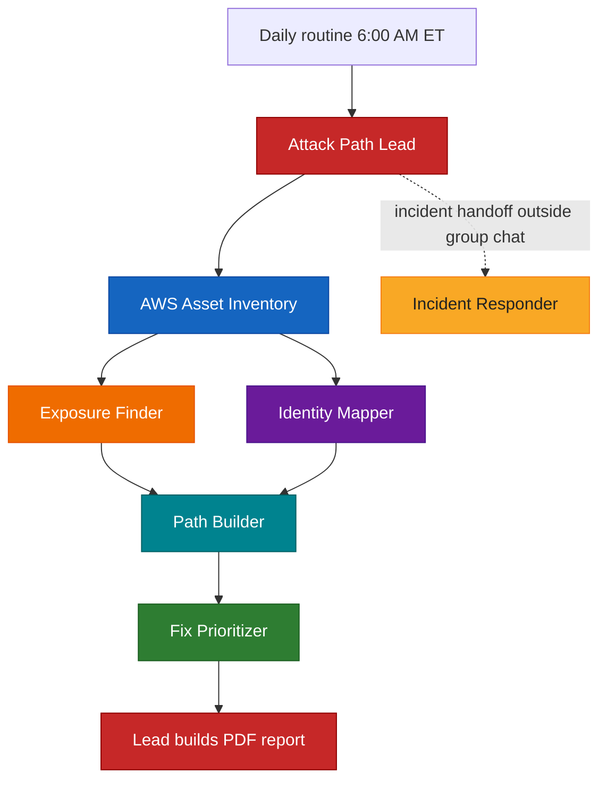

# AWS Cloud Attack Path Team

A team of seven Grok Bot agents that maps real attack paths in an AWS account every day, ranks what an attacker could do next, and proposes fixes — all read-only, with Ritvik approving every change.

## Project description

An AWS account accumulates footholds: long-lived admin keys with no MFA, federation roles that trust the wrong audience, open security groups, public API stages, buckets that look private until a trust policy lets someone in. Checking that by hand means paging through IAM, CloudTrail, GuardDuty, S3, EC2, and API Gateway and then connecting the dots. Miss one link and the path stays live.

This project splits that job across a small team of Grok Bot agents. One lead, the **Attack Path Lead**, runs the daily sweep, stitches specialist findings into ranked paths, and produces one PDF. Five specialists each cover one slice of the account (inventory, exposure, identity, path construction, fix ordering). A sixth agent, the **Incident Responder**, sits outside the group chat and takes active-compromise handoffs that the Lead relays. Everything runs through the AWS connector with **ReadOnlyAccess** and **SecurityAudit** only. Every command and its exact output is posted in the room and logged to `commands.log`.

The team never changes AWS. Ritvik approves every AWS change, every business-context call, every data copy, and every outside contact, and gets an immediate alert on active compromise.

## Key features

- **Seven agents with clear roles.** A lead, five specialists on the daily path, and an Incident Responder for active compromise.
- **One daily sweep at 6:00 AM ET.** Inventory runs first; Exposure Finder and Identity Mapper run in parallel; Path Builder and Fix Prioritizer follow; the Lead builds the PDF.
- **Paths, not a pile of findings.** Specialists report evidence; Path Builder chains it into entry → foothold → escalation → impact; Fix Prioritizer orders remediations by risk and effort.
- **Read-only by design.** The AWS connector uses ReadOnlyAccess + SecurityAudit. No agent attaches policies, opens ports, or deletes resources.
- **Full command audit.** Every AWS call and its exact output is posted and appended to `commands.log`.
- **You stay in control.** Ritvik approves every AWS change, business-context judgment call, data copying, and outside contact, and is alerted immediately on active compromise.

## Safeguards

- **Read-only AWS access.** Agents only call APIs allowed by ReadOnlyAccess and SecurityAudit. They never mutate the account.
- **Human approval for anything that leaves the box.** Ritvik approves every AWS change (run by a human or a separate change process), every business-context call, every copy of account data off the box, and every contact outside the team.
- **Immediate alert on active compromise.** Signs of an attacker operating now (deleted GuardDuty, stopped CloudTrail, unexpected admin key use) page Ritvik right away; they do not wait for the daily PDF.
- **Secrets stay masked.** Access key IDs appear only as masked suffixes. Secret key material is never printed.
- **Incident Responder stays out of the group chat.** The Lead relays handoffs so day-to-day path work and active response do not mix.
- **No real account data in this repo.** The sample report is redacted. `commands.log` and live inventory stay on the Grok Bot computer.

## Architecture

  

<b>Figure 1. How the AWS attack path team works</b>

Each agent has its own color matched to its role: Lead red, Inventory blue, Exposure Finder orange, Identity Mapper violet, Path Builder cyan, Fix Prioritizer green, Incident Responder yellow.

<b>Mermaid source for the same flow</b>

### How it works, step by step

1. **The daily routine fires at 6:00 AM ET.** The Attack Path Lead starts the sweep and posts the run plan in the team room.
2. **AWS Asset Inventory runs first.** It takes a read-only picture of the account: IAM users and roles, compute, networking, S3, regional services, and which regions are in use. Downstream agents work from that inventory.
3. **Exposure Finder and Identity Mapper run in parallel.**
   - **Exposure Finder** looks for what is reachable from outside: open security groups, public or mis-blocked buckets, public API Gateway stages, missing account-level controls.
   - **Identity Mapper** looks at who can become whom: admin keys without MFA, key last-used data, role trust policies (including federation), over-permissioned inline and attached policies.
4. **Path Builder chains the evidence.** It turns inventory + exposure + identity into ranked attack paths (entry → foothold → escalation → impact), each with severity and whether it is live or needs an extra admin step.
5. **Fix Prioritizer orders the remediations.** Each path gets concrete fix proposals, ordered by risk reduction versus effort, still without applying any change.
6. **The Lead builds the PDF.** One report for the day lands on the Grok Bot computer. A redacted sample is in this repo: [docs/sample-report.pdf](docs/sample-report.pdf).
7. **Incident Responder gets handoffs outside the group chat.** When the Lead sees active compromise, it relays to the Incident Responder and alerts Ritvik immediately. Day-to-day path work stays in the team room.

## Specialist details

### Attack Path Lead

Coordinates the team, owns the daily routine, combines specialist output into one report, and is the only agent that talks to the Incident Responder about active compromise. It never changes AWS.

### AWS Asset Inventory

Read-only. Enumerates IAM, EC2/VPC, S3, and regional control-plane services across the account. Produces the inventory the rest of the team reads. Logs every command and output.

### Exposure Finder

Read-only. Finds public and near-public surfaces: security group ingress, S3 public-access block gaps, API Gateway methods without auth, and similar exposure that can be an entry or impact step.

### Identity Mapper

Read-only. Maps principals, access keys, MFA, attached and inline policies, and role trust (including web identity). Flags admin without MFA, unused admin keys, and federation trusts that are too open.

### Path Builder

Read-only relative to AWS. Builds the graph of usable paths from the other specialists' evidence. Each path states entry, foothold, escalation, impact, severity, and whether it is live today.

### Fix Prioritizer

Read-only relative to AWS. Turns each path into ordered remediation steps with exact proposed commands. It never runs those commands; Ritvik approves any change.

### Incident Responder

Handles active-compromise work. It is not in the daily group chat. The Lead relays handoffs. Template link pending.

## Tech stack

- **Grok Bot** runs the seven agents, the team room, messaging, memory, and the 6:00 AM ET routine.
- **AWS connector** on the Grok Bot computer with **ReadOnlyAccess** and **SecurityAudit** managed policies.
- **Python on the Grok Bot computer** turns inventory and findings into path diagrams and the daily PDF.
- **`commands.log`** on the Grok Bot computer records every command and its exact output (not published in this repo).

## Set it up in your own Grok Bot

**What you need**

- A Grok Bot account
- An AWS account (or role) the connector can assume with ReadOnlyAccess + SecurityAudit only
- Ritvik (or the account owner) available to approve changes and business-context calls

### 1. Connect AWS read-only

Connect the AWS connector in Grok Bot using a role or user limited to ReadOnlyAccess and SecurityAudit. Do not grant write permissions to the team.

### 2. Import the agents

Each agent below (except Incident Responder) is a public Grok Bot template. Open the link and import it.

| Agent | What it does | Template |
|-------|--------------|----------|
| Attack Path Lead | Team lead. Runs the 6 AM ET sweep, stitches paths, builds the PDF, relays incidents. | [Import](https://x.ai/bot/tHtDUuOEcYXkO-D9FwBWz) |
| AWS Asset Inventory | Read-only account inventory; runs first each day. | [Import](https://x.ai/bot/6NM_MszjwexFsGKsY4DIf) |
| Exposure Finder | Finds public and near-public AWS exposure. | [Import](https://x.ai/bot/lRhLw_E1fuiDOOfzrVXZu) |
| Identity Mapper | Maps IAM users, roles, keys, and trusts. | [Import](https://x.ai/bot/zbBBmmX_6WMwN_TN5o0oB) |
| Path Builder | Builds ranked attack paths from specialist evidence. | [Import](https://x.ai/bot/t-tM9nEjrZYjF0ZfDb8D3) |
| Fix Prioritizer | Orders remediations by risk and effort; proposes exact fixes. | [Import](https://x.ai/bot/Ti051Yd5qCLbZ6LhfX5Wa) |
| Incident Responder | Active-compromise response via Lead handoff (outside group chat). | *No template yet* |

Import the six published templates before you continue. Create Incident Responder by hand when you need it, using yellow as its color.

<b>Prefer to build the team by hand instead of importing?</b>

Create one Grok Bot agent for each role. Give each one its color so you can tell them apart.

| Agent | Color |
|-------|-------|
| Attack Path Lead | Red |
| AWS Asset Inventory | Blue |
| Exposure Finder | Orange |
| Identity Mapper | Violet |
| Path Builder | Cyan |
| Fix Prioritizer | Green |
| Incident Responder | Yellow |

Standing rules to send the Lead (and have it share with the team):

- Every finding has severity (Info, Low, Medium, High, or Critical), evidence, a false-positive note, and a proposed fix command that the specialist never runs.
- AWS access is read-only (ReadOnlyAccess + SecurityAudit). No agent mutates the account.
- Log every command and its exact output to the room and to `commands.log`.
- Ritvik approves every AWS change, business-context call, data copy, and outside contact.
- Alert Ritvik immediately on active compromise; Lead relays those cases to Incident Responder outside the group chat.
- Never print secrets; mask access key IDs.

### 3. Set up the Attack Path Lead

Open the Lead's chat and answer its setup questions: which AWS connector to use, that the specialists are imported, and confirm the daily routine at **6:00 AM ET**. Ask it to create the team room, post the standing rules, and schedule the routine. Do not start a live scan until every specialist has the Lead named as its lead and the same AWS connector.

### 4. Wire the specialists

For each specialist, open its chat once, point it at the same AWS connector, name the Attack Path Lead as its lead, and confirm it posts findings and full command output to the team room.

## How to use it

### Every day: the sweep

At 6:00 AM ET the Lead runs Inventory → (Exposure Finder ∥ Identity Mapper) → Path Builder → Fix Prioritizer → PDF. Review the PDF; approve any fixes yourself (or through a separate change process). Nothing in the daily path applies changes for you.

### When something looks like active compromise

The Lead alerts Ritvik immediately and relays to the Incident Responder outside the group chat. Preserve evidence; do not let any agent "clean up" until you say so.

### Sample report

A redacted sample of a real daily PDF (account ID and all principal, IP, key, bucket, API, and federation identifiers replaced) is here:

**[docs/sample-report.pdf](docs/sample-report.pdf)**

## Limitations

- Read-only connectors cannot prove every write-path side effect; some paths are labeled as needing an admin step.
- CloudTrail history and disabled logging limit attribution for older events.
- Incident Responder has no public template yet.
- This repository never includes live `commands.log`, credentials, or unredacted account data.
